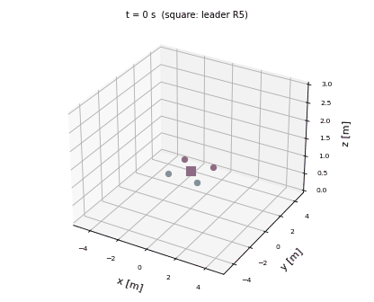
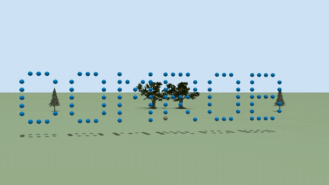
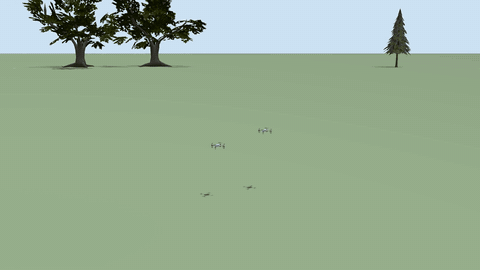

# Sliding Mode Formation Control of Quadrotors: Gazebo Simulation

Gazebo simulation based on the paper *Diseño de Control de Formación basado en Modos Deslizantes para un Grupo de Quad-Rotors* (COMRob 2023). Five ESP-drones fly in a leader-follower formation. Drone R5 is the leader and follows a trajectory, and the other four keep a fixed position relative to it. The attitude of the drones can be controlled by five different controllers, so they can be compared on the same flight:

| Name | Controller |
|---|---|
| `pid` | PID |
| `tc` | Continuous Twisting |
| `sta` | Super-Twisting Algorithm |
| `stsmc` | Continuous Singular Terminal Sliding Mode |
| `ntsmc` | Continuous Non-Singular Terminal Sliding Mode |

The repository also reproduces the two-drone experiment of the paper of [CNCA 2023](#cnca-2023).



This repository is based on the simulation of the paper, but it uses another drone and other code. See [Differences from the paper](#differences-from-the-paper).

## How to cite

If you use this code, please cite the paper you are reproducing and this repository.

```bibtex
@inproceedings{rodriguez2023formacion,
  author    = {Rodríguez-Cervantes, J. C. and Dzul, A. and Ríos, H.},
  title     = {Diseño de Control de Formación basado en Modos Deslizantes para un Grupo de {Quad-Rotors}},
  booktitle = {XXV Congreso Mexicano de Robótica (COMRob)},
  address   = {Xalapa, México},
  year      = {2023}
}
```

```bibtex
@inproceedings{rodriguez2023formation,
  author    = {Rodríguez-Cervantes, J. C. and Dzul, A. and Ríos, H.},
  title     = {Formation Control Design for Multi-Quad-Rotors with Experimental Validation},
  booktitle = {Congreso Nacional de Control Automático (CNCA), AMCA},
  address   = {Acapulco, Guerrero, México},
  year      = {2023}
}
```

```bibtex
@software{rodriguez2026comrob2023sim,
  author = {Rodriguez, Julio Cesar},
  title  = {COMRob 2023 Sliding Mode Formation Simulation},
  year   = {2026},
  url    = {https://github.com/juliordzcer/sliding-mode-formation}
}
```

## ROS 2 and no ROS

This `main` branch uses **ROS 2**: a ROS node commands the drones and a bridge connects it to Gazebo. The `no-ros` branch is the same simulation without ROS.

## What you need

- A computer with **Ubuntu 24.04**, because ROS 2 Jazzy needs it.
- About 10 GB of free disk space. No special GPU is needed, because the drones have no cameras here.

You do not need to know ROS or Python to run it. Copy each block into a terminal (`Ctrl+Alt+T` opens one) and press Enter.

## Installation

**1. Download the repository**

```bash
sudo apt update && sudo apt install -y git
mkdir -p ~/ws_comrob2023_ros/src
cd ~/ws_comrob2023_ros/src
git clone https://github.com/juliordzcer/sliding-mode-formation.git
```

**2. Install ROS 2, Gazebo and the other dependencies**

This asks for your password and takes a while.

```bash
cd ~/ws_comrob2023_ros/src/sliding-mode-formation
./install_deps.sh
```

**3. Build**

```bash
source /opt/ros/jazzy/setup.bash
cd ~/ws_comrob2023_ros
colcon build --symlink-install
```

It should end with `1 package finished`.

**4. Prepare each new terminal**

```bash
source /opt/ros/jazzy/setup.bash
source ~/ws_comrob2023_ros/install/setup.bash
```

## Running the simulation

```bash
ros2 launch comrob2023_formation formation.launch.py controller:=ntsmc
```

Gazebo and the control panel open after a few seconds. In the Gazebo window, press the view button or scroll to find the drones. Then:

1. Press **Take Off** and wait until the drones hover at 1 m, about 8 s.
2. Press **Automatic Mode**. The leader starts the trajectory and the panel shows the formation error.
3. Press **Land** to finish.

**Emergency Stop** turns the motors off, so the drones fall. To close everything, press `Ctrl+C` in the terminal.

### Options

| Option | Values | Default | What it does |
|---|---|---|---|
| `controller` | `pid`, `tc`, `sta`, `stsmc`, `ntsmc` | `ntsmc` | Attitude controller |
| `headless` | `true`, `false` | `false` | Run Gazebo without its window |
| `run_gui` | `true`, `false` | `true` | Open the control panel |
| `disturbance` | `true`, `false` | `false` | Apply the disturbance forces and torques of the paper |
| `time_scale` | number | `0.5` | Speed of the trajectory. `1.0` is the speed of the paper |
| `auto_sequence` | `true`, `false` | `false` | Take off, fly and land without the panel |
| `duration` | seconds | `50.0` | Automatic mode with `auto_sequence` |
| `output` | folder | empty | Save the flight as a CSV with `auto_sequence` |
| `formation` | `paper`, `cnca2023`, `pyramid`, `letters` | `paper` | See [Large formations](#large-formations) and [CNCA 2023](#cnca-2023) |
| `levels` | number | `4` | Layers of the pyramid: 3, 4, 5 and 6 give 14, 30, 55 and 91 drones |
| `text` | letters | `COMROB` | Letters to form, from A to Z. `COMROB` gives 101 drones |
| `spacing` | meters | `1.2` | Distance between neighbors in a pyramid or letters |

### Topics

| Topic | Type | Content |
|---|---|---|
| `/state` | `std_msgs/Int32` | 0 idle, 1 take off, 2 automatic, 3 land, 4 stop |
| `/model/espdroneN/pose` | `geometry_msgs/Pose` | Pose of drone N |
| `/espdroneN/cmd_position` | `geometry_msgs/Pose` | Position command of drone N |
| `/espdroneN/cmd_vel_world` | `geometry_msgs/Twist` | Velocity command of drone N, on the way to a large formation |
| `/espdroneN/motor_enable` | `std_msgs/Bool` | Motors of drone N |
| `/formation_error` | `std_msgs/Float64MultiArray` | Time, then the error of each follower in meters |

## Reproducing the results

Run one flight for each controller, changing `controller` and the folder:

```bash
ros2 launch comrob2023_formation formation.launch.py controller:=ntsmc headless:=true run_gui:=false auto_sequence:=true disturbance:=true output:=results
```

The node prints the error when the automatic mode ends and saves `results/ntsmc.csv`. Press `Ctrl+C` once the drones have landed.

## Results

Flights of the `no-ros` branch, with the disturbance forces and torques of the paper, at half the speed of the paper, with and without the disturbance observer. The errors are the RMS of the followers after the first 20 s, averaged over 3 flights. The peak is the largest error of a follower on any axis in those flights.

| Controller | Observer | x [m] | y [m] | z [m] | Worst peak [m] |
|---|---|---|---|---|---|
| PID | Yes | 0.190 | 0.154 | 0.022 | 0.62 |
| PID | No | 0.180 | 0.163 | 0.023 | 0.46 |
| STSMC | Yes | 0.189 | 0.208 | 0.022 | 0.38 |
| STSMC | No | 0.182 | 0.215 | 0.023 | 0.39 |
| NTSMC | Yes | 0.194 | 0.205 | 0.022 | 0.39 |
| NTSMC | No | 0.187 | 0.213 | 0.023 | 0.41 |
| STA | Yes | 0.195 | 0.203 | 0.023 | 0.38 |
| STA | No | 0.186 | 0.213 | 0.023 | 0.39 |
| TC | Yes | 0.192 | 0.205 | 0.022 | 0.39 |
| TC | No | 0.188 | 0.209 | 0.023 | 0.39 |

Most of the error comes from the leader, which lags behind its trajectory, and the followers inherit that lag, so the five controllers end up close. PID has the lowest error in y and also the largest peak. With every controller, the observer lowers the error in y a little and raises it in x a little, and it only changes the peak clearly with PID, where it is larger. These do not reproduce the ranking of the paper, where NTSMC has the lowest error.

These results are for this drone and these gains, so they do not replace the ones in the paper.

## Large formations

Each follower only needs the position of the leader and its own offset, so the same control flies many more drones.



In this image the drones are drawn five times larger so that they can be seen. The positions come from a flight of 101 drones with NTSMC and the disturbances of the paper, with 1 m between neighbors.

```bash
ros2 launch comrob2023_formation formation.launch.py formation:=pyramid levels:=4 headless:=true
ros2 launch comrob2023_formation formation.launch.py formation:=letters text:=COMROB headless:=true
```

The leader is the drone of the lowest layer closest to the center. The drones first climb straight up to 2.5 m and then go to their place at the same time, on straight lines chosen so that they stay apart. The landing does the same in reverse.

With ROS 2, the NTSMC controller flew 5, 30, 55 and 101 drones with disturbances, with a peak of 0.40 m or less and without drones closer than 0.82 m. The table comes from flights of the `no-ros` branch. These flights have the disturbances of the paper, at half the speed of the paper, with the observer and the gains of the table above. The errors are the RMS of the followers after the first 20 s, and the peak is the largest error of a follower on any axis. Each row is one flight.

| Controller | Drones | x [m] | y [m] | z [m] | Peak [m] | Smallest distance [m] |
|---|---|---|---|---|---|---|
| NTSMC | 14 | 0.193 | 0.205 | 0.022 | 0.41 | 0.81 |
| NTSMC | 30 | 0.194 | 0.206 | 0.022 | 0.38 | 0.82 |
| NTSMC | 55 | 0.188 | 0.200 | 0.023 | 0.38 | 0.82 |
| NTSMC | 91 | 0.115 | 0.121 | 0.022 | 0.24 | 0.97 |
| NTSMC | 101 | 0.122 | 0.132 | 0.022 | 0.29 | 0.98 |
| STSMC | 30 | 0.189 | 0.207 | 0.022 | 0.41 | 0.84 |
| STSMC | 101 | 0.124 | 0.133 | 0.022 | 0.37 | 0.98 |
| TC | 30 | 0.191 | 0.202 | 0.022 | 0.38 | 0.83 |
| TC | 101 | 0.118 | 0.128 | 0.022 | 0.25 | 0.98 |
| STA | 30 | 0.191 | 0.206 | 0.023 | 0.38 | 0.82 |
| PID | 30 | 0.178 | 0.151 | 0.023 | 1.00 | 0.34 |
| PID | 91 | 0.264 | 0.257 | 0.023 | 1.79 | 0.06 |
| PID | 101 | 0.219 | 0.233 | 0.023 | 3.20 | 0.38 |

NTSMC, STSMC and TC keep the formation up to 101 drones. PID gets worse as drones are added, and with 91 drones two of them come within 6 cm.

STA with 101 drones failed in 1 of 3 flights, with a peak of 17 m and at least one drone on the ground. That flight ran with many others on the same computer. The other two had a peak of about 0.25 m, and the cause of the failure was not found.

The lower errors with 91 and 101 drones are not a benefit of having more drones. The leader, which follows the same trajectory, also has a lower error in those flights (about 0.11 m against 0.18 m). In the ROS 2 version, 101 drones with NTSMC have 0.196 m in x and 0.205 m in y, the same as 5 drones, with a peak of 0.40 m. So this comes from how this version runs when the simulation is slower. Compare only flights of a similar size.

**How long it takes.** Gazebo slows down with more drones, measured without flying: 0.76× real time with 25 drones, 0.40× with 50 and 0.20× with 100, on an Intel i7-14650HX. Use `headless:=true` with many drones, because the Gazebo window was not tested with them.

## Differences from the paper

| | Paper | This repository |
|---|---|---|
| Simulator | Numerical simulation | Gazebo, with propellers and motor dynamics |
| Drone | Crazyflie, 32 g | ESP-drone model, 63 g |
| Position control | Virtual controls of the paper | Cascade of position and velocity loops of the drone firmware |
| Disturbance observer | FT-SMO | The same observer, with its estimate applied through the attitude and thrust commands of the firmware cascade |
| Disturbances | Forces and torques | The same, scaled to the mass and inertia of this drone |
| Trajectory | As in the paper | Half the speed by default, because the paper's speed reaches 1.9 m/s |
| Height | `z_d` printed with `tan` | `tanh`, starting from hover at 1 m |
| Gains | Table of the paper | Tuned in flight for this drone |

The attitude laws of the plugins follow the equations of the paper.

## CNCA 2023

This repository also reproduces the paper *Formation Control Design for Multi-Quad-Rotors with Experimental Validation* (CNCA 2023). It is the same `tc` controller, with two drones and without the observer of COMRob 2023. The drone R2 is the leader, and R1 follows it at the formation vector `[0.5, 0, 0.1]` m of the paper.



```bash
ros2 launch comrob2023_formation formation.launch.py controller:=tc formation:=cnca2023
```

In 3 flights without disturbances, at the speed of the paper, the RMS error of the follower after the first 20 s is 0.119 m in x, 0.117 m in y and 0.022 m in z. The leader has 0.111 m, 0.110 m and 0.022 m, so here too most of the error comes from the lag of the leader. These flights are in Gazebo and the paper is an experiment, so these values do not replace the ones in the paper.

| | Paper | This repository |
|---|---|---|
| Platform | Experiment with two Crazyflie | Gazebo with two ESP-drone models |
| Position control | PID of the paper | Cascade of position and velocity loops of the drone firmware |
| Attitude control | Continuous Twisting, with the gains of the paper | Continuous Twisting, with gains tuned in flight for this drone |
| Height `h` of the trajectory | Not given in the paper | 1 m |
| Start | From the ground, following `z_d` | From hover at 0.5 m, because `z_d` starts almost at the ground |

## Known limitations

- **Speed.** At the speed of the paper (`time_scale:=1.0`), the controllers were not tuned and the tracking error is much larger.
- **Windows.** The panel was tested on a virtual display, and flights were tested with Gazebo in headless mode.

## Common problems

**`Package 'comrob2023_formation' not found`**: run the two `source` commands of step 4 in that terminal.

**A change has no effect, or plugins are missing**: build again with the command of step 3.

**The drones stay on the ground**: close everything with `Ctrl+C`, check that no earlier simulation is still running with `pgrep -a ruby`, and start again.

## Repository layout

| Folder | Content |
|---|---|
| `plugins` | Motor model, position controller and attitude controllers for Gazebo |
| `models/espdrone` | ESP-drone model |
| `worlds` | Gazebo world |
| `nodes` | ROS nodes: formation commands and control panel |
| `launch` | Launch file with Gazebo and the bridge |
| `comrob2023_formation` | Formation, trajectory, gains and world generation |

## License

The code is under the [Apache License 2.0](LICENSE). Keep the [NOTICE](NOTICE) file in copies and derived works.

The ESP-drone model in `models/espdrone` was designed by Julio Cesar Rodriguez, who also measured its parameters on the real drone. It is under the [Creative Commons Attribution 4.0](models/espdrone/LICENSE) license, so credit him if you use or adapt it.

Contact: Julio Cesar Rodriguez, contact@juliordz.com
